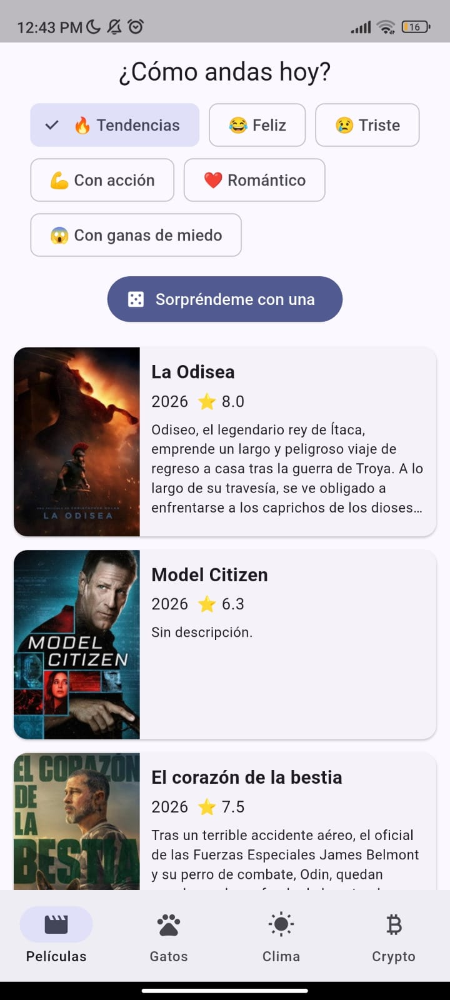
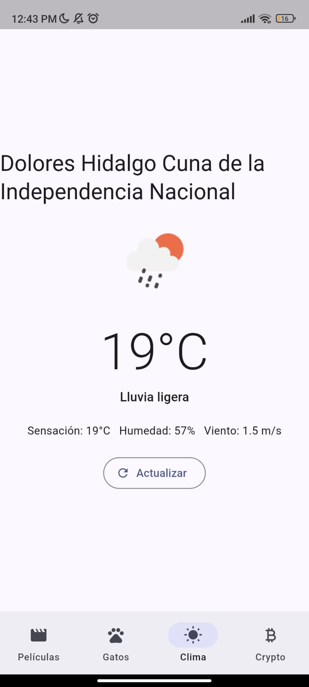
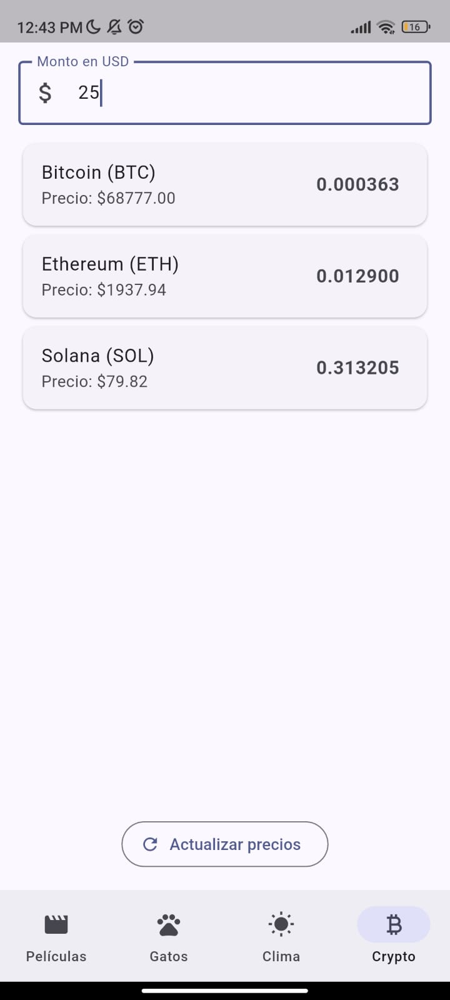

# Retos Flutter

App en Flutter con 4 mini apps que consumen APIs públicas, una por pestaña.

## Retos

| Reto | API | Qué hace |
|---|---|---|
| Recomendador de películas | TMDB | Muestra películas según el estado de ánimo o una al azar |
| Memes de gatos | Cataas | Pone la frase del usuario sobre un gato aleatorio |
| Clima minimalista | OpenWeatherMap | Clima actual con geolocalización (con respaldo en Celaya) |
| Convertidor de criptos | CoinGecko | Precio de BTC, ETH y SOL y cuántas fracciones compras con tus USD |

## Capturas

| Películas | Gatos |
|---|---|
|  |  |

| Clima | Crypto |
|---|---|
|  |  |

## Estructura

```
lib/
├── main.dart          # arranque de la app
├── config.dart        # API keys
├── models/            # Movie, Weather
├── services/          # llamadas a las APIs
├── screens/           # una pantalla por reto
└── widgets/           # MovieCard
test/                  # 56 pruebas
capturas/              # capturas de la interfaz
```

## Cómo correrlo

1. Clona el repo y entra a la carpeta.
2. Pon tus API keys en `lib/config.dart`:
   - TMDB: https://www.themoviedb.org/settings/api
   - OpenWeather: https://home.openweathermap.org/api_keys
3. Instala dependencias y corre:

```
flutter pub get
flutter run
```

## Pruebas

```
flutter test
```

## Permisos de ubicación

Para el clima con geolocalización:

- **Android:** en `android/app/src/main/AndroidManifest.xml`, dentro de `<manifest>`:
  ```xml
  <uses-permission android:name="android.permission.INTERNET"/>
  <uses-permission android:name="android.permission.ACCESS_FINE_LOCATION"/>
  <uses-permission android:name="android.permission.ACCESS_COARSE_LOCATION"/>
  ```
- **iOS:** en `ios/Runner/Info.plist`:
  ```xml
  <key>NSLocationWhenInUseUsageDescription</key>
  <string>Para mostrar el clima de tu ciudad</string>
  ```

Si no se configuran, la app usa Celaya por defecto.

## Tecnologías

Flutter, Dart, `http`, `geolocator`.